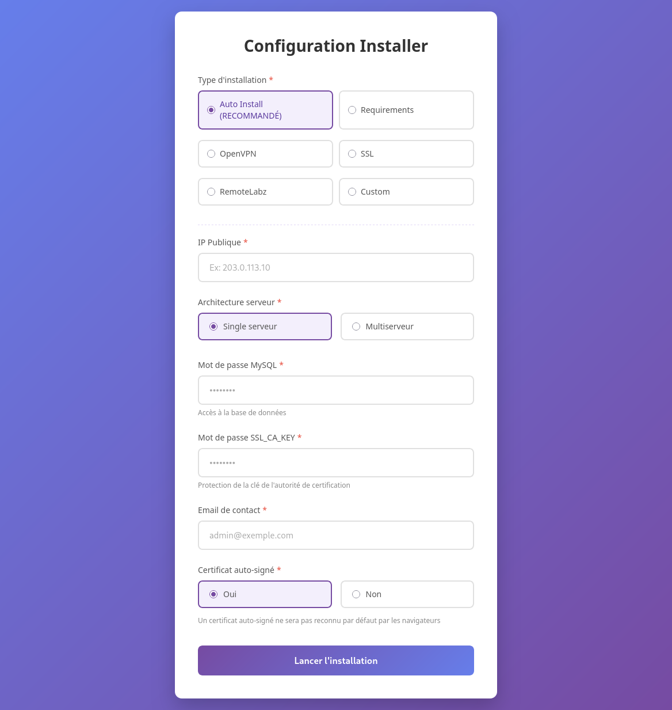

# RemoteLabz Web Installer


## 📋 Table of Contents

1. [Prerequisites](#prerequisites)
2. [Usage](#usage)
3. [Troubleshooting](#troubleshooting)

---

## Prerequisites

```
sudo apt install php8.5-cli
```


## Usage

```
sudo php -S ip:port
```


Open a browser and go to http://ip:port




## Troubleshooting

Only the installation work for now.

## TODO

- Custom installation
- English translation
- show important info at the end of the install